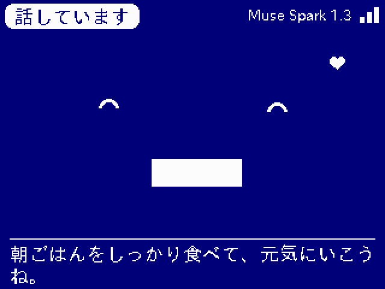
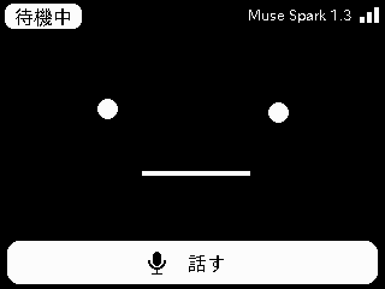
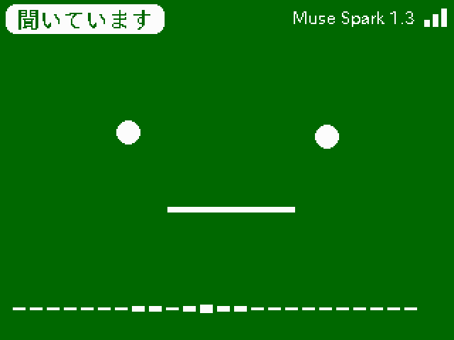
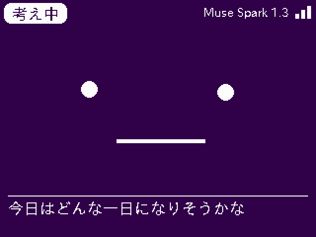

# StackChan × Muse

M5Stack CoreS3 のスタックチャンで、Meta の [Muse](https://dev.meta.ai/) と話すためのファームウェアです。



> **開発中です。** 進み具合は [CHANGELOG.md](CHANGELOG.md) を見てください。
> 実際の Muse の応答での確認は、API キーが用意できてからになります。

## 使い方

1. 画面をタップするか、頭をポンとたたきます（ピッと鳴ったら話せます）
2. 話し終わると自動で聞き取りが止まり、Muse が返事をします
3. 返事のあとは、そのまま続けて話しかけられます。話さなければ待機に戻ります

話している途中でタップすると、割り込んで話せます。考えている途中でタップすると取り消します。

| 待機中 | 聞いています | 考え中 | 話しています |
| --- | --- | --- | --- |
|  |  |  |  |

## できること

| 機能 | 使うもの | 状態 |
| --- | --- | --- |
| 顔・表情・字幕・状態表示 | 画面（m5stack-avatar） | ✅ |
| 首の動き | サーボ（校正値は本体に保存済みのものを使用） | ✅ |
| Muse への接続確認 | Wi-Fi、TLS（証明書を検証） | ✅ |
| 声で読み上げ | スピーカー（内蔵ボイス / VOICEVOX） | ✅ |
| 実画面のスクリーンショット | USB シリアル | ✅ |
| 声で話しかける | マイク → Muse Voice Transcribe | ✅ |
| Muse と会話 | Muse Spark（Chat Completions、ストリーミング） | ✅ |
| 気持ちに合わせた表情と首の動き | 画面、サーボ | ✅ |
| 見せて話す | カメラ → Muse Spark（画像入力） | 次の版 |

### 声について

Muse には文字起こしのモデルはありますが、[音声合成はありません](https://dev.meta.ai/docs/speech-to-text)。
そのため返事の読み上げは本体側で行います。
VOICEVOX サーバーが設定されていて届けばそれを使い、届かなければ内蔵ボイスで喋ります。

## 必要なもの

- M5Stack CoreS3 + スタックチャンのボディ
- 2.4GHz の Wi-Fi
- [Meta Model API](https://dev.meta.ai/) の API キー（`LLM_` で始まるもの）
- 内蔵ボイスで喋るなら、LittleFS のボイスパック
  （[stackchan-llm-mqtt-fft](https://github.com/Xenoah/stackchan-llm-mqtt-fft) を入れていた本体にはすでに入っています）

## セットアップ

```powershell
pip install pyserial pillow

# 書き込み（NVS とボイスパックは消えません）
pio run -t upload

# Wi-Fi（stackchan-llm-mqtt-fft で設定済みなら不要）
python tools/set_wifi.py "ネットワーク名"

# API キー（入力は画面に出ません）
python tools/set_key.py
```

キーは [Model API ダッシュボード](https://dev.meta.ai/) の **API keys → Create API key** で作れます。
キーは本体の NVS に保存され、ログや画面には出しません。
NVS は暗号化していないので、本体を人に渡すときは引数なしの `setkey` でキーを消してください。

## データと料金

- マイクの音声は `muse-voice-transcribe-1.0` へ、会話の文字は `muse-spark-1.3` へ送ります。
  マイクは緑の「聞いています」の間だけ使います。音声は本体に残しません
- 標準の `muse-spark-1.3` は、送った内容を Meta のモデルの学習に使いません。
  安価な `-contributor` のモデルは学習に使われるので、既定では使いません
- 料金は [Meta の料金表](https://dev.meta.ai/docs/pricing-rate-limits)を見てください
  （文字起こしは $0.18/時間、Muse Spark は入力 $1.25・出力 $4.25/100 万トークン）

## 開発用の道具

| コマンド | 内容 |
| --- | --- |
| `python tools/capture_screen.py out.png` | LCD に出ている画面をそのまま PNG にする |
| `python tools/mock_muse.py` | API キーなしで試すための Model API の代役 |
| `python tools/reply_test/run.py` | 返事を文に切り分ける処理のテスト（PC で実行） |
| `python tools/make_release.py v0.1.0` | 書き込み用ファイルを `.release/` に集める |

USB シリアル（115200bps）で次のコマンドを受け付けます。

`status` / `shot` / `listen` / `ask <文>` / `say <文>` / `forget` / `autolisten <0|1>` / `setkey <キー>` / `wifi <SSID><TAB><パスワード>` / `volume <0-255>` / `model <ID>` / `check` / `micstats` / `servo <0|1>` / `nod` / `joy` / `shake` / `calibrate` / `reboot`

`baseurl <URL>` はテスト用に接続先を差し替えます。保存はしないので、再起動すると `api.meta.ai` に戻ります。
既定以外の接続先に本物のキーは送りません。

## 構成

| ファイル | 役割 |
| --- | --- |
| [src/main.cpp](src/main.cpp) | 起動、画面の状態、タッチ、USB コマンド、見守り |
| [src/Conversation.cpp](src/Conversation.cpp) | 音声 → 文字 → 返事の流れ（専用タスク） |
| [src/MuseClient.cpp](src/MuseClient.cpp) | Meta Model API のクライアント |
| [src/Recorder.cpp](src/Recorder.cpp) | 録音、話し始めと話し終わりの判定 |
| [src/ReplySplitter.cpp](src/ReplySplitter.cpp) | 返事を文に切り分け、気持ちのタグと記号を処理 |
| [src/FaceHud.cpp](src/FaceHud.cpp) | 顔に重ねる会話 UI |
| [src/Body.cpp](src/Body.cpp) | 首の動き |
| [src/Speech.cpp](src/Speech.cpp) | 読み上げ（VOICEVOX → 内蔵ボイス） |
| [src/ScreenShot.cpp](src/ScreenShot.cpp) | 実画面の読み出し |

顔・サーボ校正・内蔵ボイスは [stackchan-llm-mqtt-fft](https://github.com/Xenoah/stackchan-llm-mqtt-fft) から移植しました。
パーティション構成も同じなので、Wi-Fi 設定・サーボ校正・ボイスパックはそのまま引き継がれます。

使っているオープンソースソフトウェアは [THIRD_PARTY_NOTICES.md](THIRD_PARTY_NOTICES.md) にまとめています。
本プロジェクトは Meta とは関係ありません。
